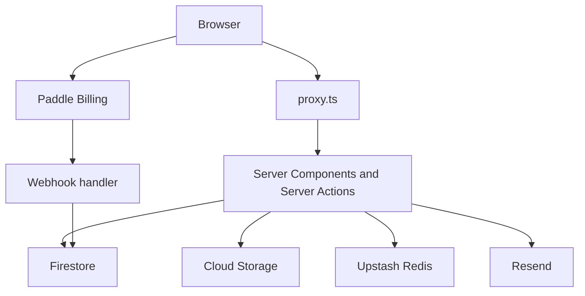

# CodeBucket

Interactive learning platform for beginner web developers. YouTube videos introduce a topic for free; the product people pay for is guided practice — exercises, projects, and a structured path with progress tracking.

**Live:** [codebucket.pl](https://codebucket.pl)


## Overview

Explanation is easy to give away. The hard part of learning to code is practice with feedback, in an order that builds on itself. CodeBucket is that layer: short lessons, multi-stage exercises, guided projects, and progress through a fixed curriculum.

Distribution is a YouTube channel. Videos there are previews. Accounts, exercises, and payments live on the platform.

What is live today:

- **HTML Fundamentals** is a free course with a full player: lessons, interactive exercises, local code exercises, guided projects, and cheatsheets.
- **CSS Basics** is in pre-sale. The landing page, Paddle checkout, and a refund window anchored to the release date are wired up. The section outline is seeded; lesson content ships with the release.

## Features

### Learning

- Course player with section and element navigation, one route per element, and animated transitions between elements.
- Interactive exercises built from ordered stages: select the correct answer, fill the gaps, fill in code, match pairs, and choose the matching item. A wrong answer on a retryable stage is queued and replayed in a second pass.
- Local code exercises with a sandboxed HTML preview beside a reference solution. The learner marks the exercise complete; free-form code is not auto-graded.
- Guided projects, cheatsheets in a fullscreen carousel, and a course-ending screen.
- Progress per signed-in user. Completing an element updates the section and the course.

### Freemium

- The first two sections of HTML Fundamentals (`introduction`, `fundamentals`) are open without an account.
- Guest progress is stored in `localStorage` and copied into the user document on the next sign-in (email, Google, or GitHub).

### Commerce

- Inline Paddle checkout, shown after the buyer accepts the terms.
- Pre-sale pricing and a release timeline on the course landing page.
- Refund requests from the account area. The window is 30 days from purchase, or from the course release date during pre-sale. The request is stored and emailed to staff and to the buyer.

### Accounts

- Email and password, plus Google and GitHub.
- Password reset and password change, both confirmed with a 6-digit code sent by email.

### Site

- Marketing home, a landing page per course, and a public roadmap.
- Terms, privacy, refund policy, and help.
- Contact form for signed-in users, with attachments and a daily limit.
- Newsletter signup for guests and for signed-in users.
- Dark theme by default, with a light theme.
- Cookie consent wired to Google Consent Mode v2.

## Tech stack

| Layer | Choice |
| --- | --- |
| Framework | Next.js 16 (App Router, Server Actions, `proxy.ts`), React 19 with the React Compiler |
| Language | TypeScript in `strict` mode, Zod 4 for runtime validation |
| UI | Tailwind CSS 4, shadcn/ui (Radix), Motion, Embla Carousel, Monaco Editor for syntax highlighting |
| Data | Firebase Auth, Cloud Firestore, Cloud Storage, Firebase Analytics, `firebase-admin` |
| Session | iron-session (encrypted cookie) |
| Cache / limits | Upstash Redis |
| Payments | Paddle Billing (`@paddle/paddle-js` and `@paddle/paddle-node-sdk`) |
| Email | Resend and React Email |
| Files | archiver, for server-side ZIP downloads |
| Hosting | Firebase App Hosting (`apphosting.yaml`) |

## Architecture



The browser hits `proxy.ts` first. That gate reads the session cookie and decides whether the request may continue. Pages and Server Actions then talk to Firestore and Storage through the Admin SDK. Redis is used for the contact-form limit. Transactional mail goes out through Resend.

Checkout runs in the browser with Paddle.js. Paddle calls the webhook, which verifies the signature and writes the order. The thank-you page runs the same fulfillment function, so a buyer gets access whether the webhook or the page lands first.

```
app/          routes: marketing site, auth, course player, checkout, webhooks
actions/      Server Actions: auth, progress, courses, storage, refunds, newsletter
lib/          domain logic: exercises, session, OTP, Paddle, course progress
schemas/      Zod models shared by content, actions, and Firestore documents
components/   UI, one component per file
emails/       React Email templates
courses/      course.json source files, seeded into Firestore
scripts/      course seed and Storage sync
```

## Technical decisions

### Firebase Auth for identity, iron-session for the application session

Firebase handles sign-in (email, Google, GitHub) and issues an ID token. The server verifies that token once, then stores `{ uid, email, issuedAt }` in an encrypted `cb_session` cookie: `httpOnly`, `SameSite=Lax`, `Secure` in production, 30-day TTL.

I wanted a session the app can revoke without waiting for a Firebase token to expire. After a password reset or change, `sessionsValidAfter` is written on the user document and Firebase refresh tokens are revoked. Every later read compares `issuedAt` with that timestamp and destroys the cookie if the session is older.

The client also gets a non-`httpOnly` `cb_auth` marker, so the UI can tell a guest from a signed-in user without ever reading the encrypted session. `proxy.ts` keeps the marker in sync with the real session.

**Trade-off:** identity and the application session are two records that have to stay aligned. The payoff is server-side revocation and a cookie the client JavaScript cannot read.

### Route gating in the Next.js 16 proxy

`proxy.ts` replaces the older middleware file. It does four jobs on the way in:

- Course element routes require a session, except the guest-free sections.
- `/change-password` redirects anonymous users to login.
- `/login`, `/signup`, and `/reset-password` redirect an already signed-in user away, and only on `GET`, so a Server Action `POST` still reaches the page.
- The `next` redirect target must start with `/` and must not start with `//`, which blocks open redirects.

### Email OTP with the code stored as a hash

Password reset and password change share one OTP service. The code is a 6-digit value from `crypto.randomInt`, stored in Firestore as a SHA-256 hash. It expires after 10 minutes, allows 5 verification attempts, allows 3 resends, and enforces a 60-second cooldown between sends. A successful reset deletes the code, updates the password through the Admin SDK, and revokes existing sessions.

I did this instead of relying on Firebase's email-link reset alone, so reset and change-password share one policy (TTL, attempts, resend limits) and the same React Email template.

### Paddle orders keyed by the transaction id

The webhook verifies the `Paddle-Signature` header with the SDK's `unmarshal` before any document is written. The Firestore order id is the Paddle transaction id, so a replay updates the same document. Granting access runs inside a Firestore transaction: on `paid`, the course ids are added to `unlockedCourses` with `arrayUnion`, which does not duplicate an id that is already there.

The same fulfillment function runs when the thank-you page loads. A delayed webhook still results in access. The order-confirmation email is sent once, guarded by an `emailSent` flag on the order.

### Refund window anchored to the release date

A normal purchase can be refunded for 30 days from the charge. A pre-sale purchase uses the course `releaseDate` as the start of that window (or `presale.refundDays` when the course sets one). Charging someone before the content exists and starting the refund clock on the charge date would punish early buyers. The request is stored as `pending` and emailed to staff and to the user.

### Course content as JSON, seeded on every production build

Each course is a `course.json` validated with Zod before it is written. `npm run build` seeds Firestore and then builds the app, so a schema error fails the deploy. The course document stores a denormalized outline (section and element ids, titles, order). Navigation reads that one document. The full element payload lives at `courses/{id}/sections/{id}/elements/{id}`.

Media stays in Cloud Storage under a path convention (`courses/{id}/...`). The seed script does not upload binaries. Dev and prod buckets are synced with `gcloud storage rsync`.

**Trade-off:** content changes require a deploy. That is acceptable at this size, and it means the curriculum in git is the curriculum in production.

### Exercise engine as a client-side state machine

An interactive exercise is a sequence of stages. A controller composes per-stage state, a flow (`main`, then `retry`), and derived values such as whether the stage is complete. Checking an answer returns immediately in the browser. Retryable stages that were answered wrong are shuffled into a second pass.

Correct answers ship inside the lesson payload. These exercises are practice, with no grade and no certificate, so a round trip to hide the answer would add latency without protecting anything that matters. Instant feedback is the product.

### Redis for one limit

Upstash Redis backs the contact form. The key is `contact:rl:{uid}:{YYYY-MM-DD}` in the Europe/Warsaw calendar day. `INCR` plus `EXPIRE` until the next Warsaw midnight caps a user at 3 messages a day. If sending the email fails, the slot is released with `DECR`. If Redis is down, the request is rejected rather than left unlimited.

Sessions, OTP, and course cache do not go through Redis. Firestore already holds that state, and a second store would be another thing to keep correct.

### Writes only through the Admin SDK

Firestore rules allow public read of course content and deny every client write. User documents, orders, OTP hashes, refund requests, and newsletter subscriptions are not in the public rules, so the client SDK cannot touch them. Mutations go through Server Actions and route handlers, each input parsed with Zod. Redis and the rate limiter are imported with `server-only`, so a client bundle that reaches them fails the build.

The HTML preview iframe is created with `sandbox=""` (no scripts, no same-origin, no forms). Storage paths that contain `..` are rejected before any download or ZIP is built. Material ZIPs are written to a temp object and handed out as a signed URL that expires after one hour.

### Analytics behind Consent Mode v2

The root layout sets Consent Mode defaults to denied before the app hydrates, then upgrades `analytics_storage` and `ad_storage` from the `cb_cookie_consent` cookie. Firebase Analytics is initialized in production only, under a separate `gtag` name (`gtagFirebase`), so the analytics snippet does not overwrite the consent `gtag`. Events cover signup, login, course views, checkout, and purchase.

### React Compiler for render memoization

`reactCompiler: true` is on in `next.config.ts`, so components stay plain functions and render output is not wrapped in `useMemo` or `React.memo`. `useCallback` is reserved for functions stored in React context or passed into the carousel, where the caller needs a stable identity.

## Project scale

About 380 TypeScript files and roughly 28,000 lines, excluding dependencies and the build output. The content schema defines 10 element types. Six transactional emails (order confirmation, contact, password reset, password change, refund request to staff, refund confirmation to the user) share one React Email layout.

## Roadmap

The content model already describes four element types whose player UI is still ahead: an in-platform code exercise (Monaco is wired today as a syntax highlighter via `editor.colorize`), interactive demos, individual projects, and custom exercises. The public roadmap lists JavaScript, Advanced JavaScript, Modern CSS, and React after the current HTML and CSS courses.
